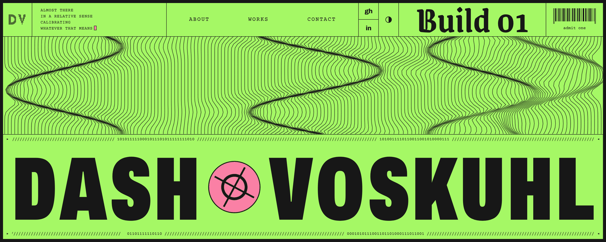

Cofounder and CEO, [Nascoron](https://nascoron.com). Agentic decoy fleets that collect intelligence on criminal networks.

## Now

- Building the Nascoron product
- Raising spring 2027
- dashvoskuhl24@gmail.com

## Built

- **Nascoron** (2026 to now): cofounder, CEO
- **[Tethr](https://github.com/dashelvoskuhl/tethr)** (Jul to Nov 2026): book a caregiver like a ride. Cofounder, CEO. Built the web app with Claude Code: 204 commits in 13 days. Private pilot with waitlist families.

## How I build

Claude Code. I write the spec, design the UI, review the code and deploy.

## Links

[dashvoskuhl.com](https://dashvoskuhl.com) · [nascoron.com](https://nascoron.com) · [LinkedIn](https://www.linkedin.com/in/dash-voskuhl-856945412/)
